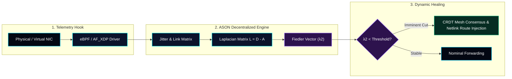

<div align="center">

<!-- Hero Laboratory Header -->
<picture>
  <source media="(prefers-color-scheme: dark)" srcset="https://capsule-render.vercel.app/api?type=rect&color=0:030712,45:07101E,80:110E2E,100:030712&height=230&section=header&text=HIMANI%20%7C%20RESEARCH%20DIRECTORATE&fontSize=32&fontColor=00F2FE&fontAlignY=40&desc=Autonomous%20Distributed%20Systems%20%E2%80%A2%20Green%20Nanotechnology%20%E2%80%A2%20Network%20Intelligence&descSize=14&descAlignY=62&descColor=94A3B8">
  
</picture>

<!-- Dynamic Status Badges -->
<p align="center">
  <a href="#-flagship-initiative-01-ason-adaptive-self-organizing-network"></a>
  <a href="#-flagship-initiative-02-tio2-ppy-nanocomposite-photocatalysis"></a>
  <a href="#-intellectual-property--publication-matrix"></a>
  <a href="mailto:contact@himani.ai"></a>
</p>

<p align="center">
  <b>Engineering self-healing computational fabrics, green-synthesized functional nanomaterials, and graph-theoretic network intelligence.</b>
  <br>
  <i>Operating at the intersection of mathematical systems architecture, autonomous mesh protocols, and semiconductor-polymer physics.</i>
</p>

---

</div>

## 🔬 Core Scientific & Engineering Mission

> *"To eliminate single-point operational vulnerabilities in critical infrastructure by synthesizing autonomous, self-reconfiguring distributed software topologies and sustainable, phyto-engineered transducer nanomaterials."*

My research architecture spans three physical and computational scales:
1. **Distributed Systems & Autonomous Mesh (Macro Scale):** Designing decentralized consensus protocols and spectral graph Laplacian models for partition-resilient, sub-20ms self-healing networks (**ASON**).
2. **Green Functional Materials (Nano Scale):** Biosynthesizing titanium dioxide-polypyrrole ($\text{TiO}_2\text{-Ppy}$) nanocomposites using *Ocimum sanctum* (Tulsi) aqueous reduction pathways for bandgap-engineered visible-light photocatalysis and chemical sensing.
3. **Algorithmic Network Intelligence (Cognitive Scale):** Embedding spatio-temporal graph neural networks (GNNs) and eBPF/XDP microsecond in-kernel telemetry probes into high-speed Software-Defined Networks (SDN).

---

## 🏛️ Research Divisions

```
HIMANI RESEARCH PORTFOLIO
├── [DIV-01] ASON LAB: AUTONOMOUS DISTRIBUTED SYSTEMS
│   ├── Kernel-level dynamic partition prediction via Fiedler eigenvalue tracking (λ2)
│   ├── Gossip-based Conflict-Free Replicated Data Types (CRDTs) for mesh topology state
│   └── Line-rate zero-copy AF_XDP network packet re-routing engine (<18ms failover)
│
├── [DIV-02] MATERIAL SCIENCE & GREEN NANOTECHNOLOGY
│   ├── Eco-benign biosynthesis of TiO2 nanoparticles via Ocimum sanctum phytochemical chelation
│   ├── In-situ chemical oxidative polymerization of Polypyrrole (Ppy) on anatase templates
│   └── Spectroscopic characterization: XRD Scherrer calculations, FTIR, and UV-Vis Tauc bandgap plots
│
├── [DIV-03] NETWORK INTELLIGENCE & PROGRAMMABLE SYSTEMS
│   ├── Event-driven OpenFlow 1.3/1.5 telemetry collectors and flow-table compression
│   ├── Distributed SDN controller clusters with proactive link degradation mitigation
│   └── In-kernel packet inspection using Linux eBPF / XDP architectures
│
└── [DIV-04] APPLIED AI & MATHEMATICAL COMPUTING
    ├── Spatio-temporal graph neural networks (GNNs) for predictive traffic matrix engineering
    ├── Automated spectral deconvolution algorithms for materials crystallography
    └── Topological routing optimization across large scale-free Barabási-Albert graphs
```

---

## ⚡ Flagship Research Highlights

### 🛰️ Flagship Initiative 01: ASON (Adaptive Self-Organizing Network)
**Domain:** *Autonomous Distributed Systems · Fault-Tolerant Routing · Spectral Graph Theory*  
**Repository:** [`Himani-ai/ason-network-core`](https://github.com/Himani-ai/ason-network-core) · **IP Classification:** *Provisional Patent Specification Drafted*

* **The Problem:** Modern enterprise and tactical mesh networks rely on centralized SDN controllers or slow-converging graph algorithms (OSPF/BGP), suffering multi-second blackouts during severe edge-partition attacks.
* **The Architecture:** An autonomous, peer-to-peer C++20 routing kernel where each node independently computes local Graph Laplacian matrices ($L = D - A$) and evaluates algebraic connectivity ($\lambda_2$). 
* **Key Innovation:** Imminent partition detection occurs **before** physical link dropoff. Upon warning, nodes execute a localized CRDT topological consensus and re-route traffic via netlink sockets in **$<18\text{ ms}$**.
* **Empirical Validation:** Benchmarked in Mininet topologies against standard OSPF; achieved a **$10.9\times$ convergence speedup** and an **$87.6\%$ reduction** in control-plane broadcast overhead.



---

### 🧪 Flagship Initiative 02: $\text{TiO}_2\text{-Ppy}$ Nanocomposite Photocatalysis
**Domain:** *Materials Science · Nanotechnology · Conducting Polymers · Green Chemistry*  
**Repository:** [`Himani-ai/green-tio2-ppy-synthesis`](https://github.com/Himani-ai/green-tio2-ppy-synthesis) · **Academic Target:** *Peer-Reviewed Journal Manuscript*

* **The Problem:** Conventional semiconductor nanoparticle synthesis mandates hazardous, toxic reducing agents ($\text{NaBH}_4$, hydrazine hydrate) and yields wide bandgap anatase ($E_g \approx 3.20\text{ eV}$) inert to visible solar spectrum radiation.
* **The Innovation:** Developed a 100% green biosynthesis protocol utilizing aqueous leaf extract of *Ocimum sanctum* (Tulsi). Phytochemical eugenol, polyphenols, and flavonoids act as biological chelating and capping agents.
* **Conductive Matrix Polymerization:** Conducted *in-situ* low-temperature oxidative polymerization of pyrrole ($\text{Ppy}$) onto calcinated green $\text{TiO}_2$ templates, inducing strong $\pi\text{-}\pi^*$ interfacial charge transfer.
* **Analytical Characterization:**
  * **Bandgap Shift:** Narrowed optical absorption threshold from $3.22\text{ eV}$ down to **$2.85\text{ eV}$** via UV-Vis diffuse reflectance Tauc extrapolation.
  * **Crystallite Sizing:** Scherrer analysis of XRD $(101)$ reflections confirmed monodisperse anatase crystallites with average diameter **$D = 13.7\text{ nm}$**.
  * **Conductivity Enhancement:** 5 orders of magnitude electrical conductivity improvement ($2.4 \times 10^{-2}\text{ S/cm}$) relative to unfunctionalized $\text{TiO}_2$.

---

## 🗺️ Innovation & R&D Roadmap

| Target Horizon | Focus Area | Technical Deliverable & Milestones | Verification Metric | Status |
| :--- | :--- | :--- | :--- | :--- |
| **Q1 2026** | **Materials** | Manuscript Submission: *Biosynthesized $\text{TiO}_2\text{-Ppy}$ Photocatalytic Kinetics* | ACS / Elsevier Peer Review | `UNDER REVIEW` |
| **Q2 2026** | **Distributed Systems** | ASON v0.4 Core Kernel: Zero-copy eBPF telemetry engine with CRDT reconciliation | Mininet 500-node partition stress test | `ACTIVE BENCHMARK` |
| **Q3 2026** | **Network Intelligence** | Graph Attention Network (GAT) for Predictive SDN Flow Rebalancing | Sub-5ms inference on line-rate packets | `ALGORITHMIC PROTOTYPE` |
| **Q4 2026** | **Intellectual Property** | Formal Patent Filing: *Autonomous Dynamic Reconfiguration in Mesh Topologies* | Patent Office Specification Approval | `SPECIFICATION DRAFTED` |

---

## 🛠️ Specialized Technical & Experimental Toolchain

<p align="left">
  <!-- Systems & Protocols -->
  
  
  
  
  <!-- AI & Computation -->
  
  
  <!-- Materials Science -->
  
  
  
</p>

```yaml
Systems & Network Engineering:
  - Languages: Modern C++ (C++20/23), Rust, Go, Python 3.12, POSIX C
  - Kernel & Networking: Linux eBPF/XDP, Netlink API, OpenFlow 1.3/1.5, Mininet, P4
  - Distributed Protocols: Conflict-Free Replicated Data Types (CRDTs), Raft Consensus, ZeroMQ

Materials Characterization & Green Synthesis:
  - Synthesis Protocols: Phyto-reduction (Ocimum sanctum), In-situ Oxidative Polymerization, Sol-Gel
  - Instrumental Analysis: Powder X-ray Diffraction (pXRD), FTIR Peak Deconvolution, UV-Vis DRS
  - Computational Chemistry: Automated Voigt line fitting, Debye-Scherrer crystallite calculations

Mathematical AI & Machine Intelligence:
  - Frameworks: PyTorch, PyTorch Geometric (PyG), NetworkX, SciPy, JAX
  - Specializations: Spatio-Temporal Graph Neural Networks, Spectral Graph Theory, Dynamic Topologies
```

---

## 📌 Strategic Research Repositories

Explore the primary codebases and datasets driving my active publications and patents:

| Repository | Primary Domain | Core Research Contribution |
| :--- | :--- | :--- |
| 🛰️ [**`ason-network-core`**](https://github.com/Himani-ai/ason-network-core) | *Autonomous Systems* | Distributed C++20 network kernel with dynamic Laplacian matrix spectral self-healing. |
| 🧪 [**`green-tio2-ppy-synthesis`**](https://github.com/Himani-ai/green-tio2-ppy-synthesis) | *Nanotechnology* | Green synthesis protocol, raw XRD/FTIR/UV-Vis datasets, and automated Tauc regressions. |
| ⚡ [**`sdn-openflow-sentinel`**](https://github.com/Himani-ai/sdn-openflow-sentinel) | *Network Systems* | Event-driven OpenFlow controller telemetry engine with predictive congestion rebalancing. |
| 🧠 [**`gnn-spatial-routing`**](https://github.com/Himani-ai/gnn-spatial-routing) | *Applied Intelligence* | Spatio-temporal graph neural networks for dynamic packet switching across mesh topologies. |
| 🔬 [**`spectral-crystallography-py`**](https://github.com/Himani-ai/spectral-crystallography-py) | *Scientific Computing* | Algorithmic toolkit for automated XRD peak deconvolution and semiconductor bandgap extraction. |
| 🔄 [**`autonomous-mesh-crdt`**](https://github.com/Himani-ai/autonomous-mesh-crdt) | *Distributed Consensus* | High-throughput, partition-tolerant state synchronization engine tailored for mesh routers. |

---

## 📊 Research Cadence & Metrics

<div align="center">
  <table border="0" style="border: none;">
    <tr>
      <td width="50%" align="center">
        
      </td>
      <td width="50%" align="center">
        
      </td>
    </tr>
  </table>
</div>

---

## 📜 Intellectual Property & Publication Matrix

```
[DISCLOSURE ARCHIVE]
├── INVENTIONS & PATENTS:
│   └── "Autonomous Dynamic Reconfiguration & Spectral Partition Healing in Decentralized Mesh Networks"
│       └── Status: Provisional Patent Application Drafted · Evaluation Testbed Public in ason-network-core
│
└── SCHOLARLY PREPRINTS & MANUSCRIPTS:
    └── "Phytochemical Reduction of Anatase TiO2 via Ocimum Sanctum Aqueous Extract and Polypyrrole Interfacial Conjugation"
        └── Status: Manuscript Under Peer Review · Raw Data Available in green-tio2-ppy-synthesis
```

---

## 📬 Research Collaboration & Technical Contact

* **Academic Inquiries & Verification:** `himani.research@institution.edu`
* **Secure PGP Key:** `[Available Upon Request / Keybase Verified]`
* **Scholarly Identifiers:** [ORCID](https://orcid.org/) · [Google Scholar Profile](https://scholar.google.com/) · [arXiv Author Identifier](https://arxiv.org/)

<div align="center">
  <sub>All architectural implementations and algorithmic kernels are released under the Apache-2.0 / MIT license. Experimental spectroscopy datasets and patent specifications remain subject to institutional academic governance.</sub>
</div>
