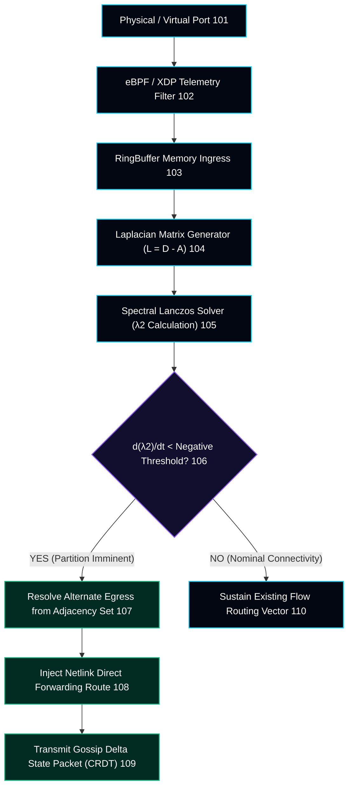

# ASON Patent & Architectural Specification Overview
### Autonomous Self-Organizing Network Architecture with Real-Time Spectral Laplacian Healing

---

## 1. Invention Title & Abstract

### Title
**"Methods, Systems, and Computer-Readable Media for Autonomous Dynamic Topology Reconfiguration and Predictive Partition Healing in Decentralized Distributed Networks"**

### Abstract
A distributed system and autonomous network control kernel are disclosed for predictive partition mitigation in arbitrary mesh topologies. Each participating network node establishes a continuous, low-overhead in-kernel packet probe utilizing extended Berkeley Packet Filters (`eBPF`) and Express Data Path (`XDP`) drivers to sample per-hop microsecond jitter, packet arrival delta, and link utilization vectors. 

Local telemetry vectors are converted into a dynamic unnormalized Graph Laplacian matrix ($L = D - A$). By computing the temporal derivative of the second-smallest eigenvalue ($\lambda_2$, the Fiedler algebraic connectivity metric), the network node infers cut-vertex degradation prior to physical link failure. 

Upon crossing an algebraic connectivity boundary threshold, the node initiates localized state synchronization via conflict-free replicated data types (CRDT) and directly injects multi-path failover egress routes into the operating system routing table via Netlink sockets, circumventing centralized software-defined controllers and eliminating global broadcast storms.

---

## 2. Core Patent Claim Structure

```
CLAIM 1 [Independent Method Claim]:
A computer-implemented method for autonomous topology healing in a decentralized network node, comprising:
  (a) capturing, via an in-kernel data-path probe, real-time link health telemetry for direct peer connections;
  (b) updating a dynamic local adjacency matrix and generating an unnormalized Graph Laplacian matrix;
  (c) calculating a temporal rate of change of an algebraic connectivity metric of the Laplacian matrix;
  (d) determining that the algebraic connectivity metric crosses a predictive partition threshold prior to link detachment; and
  (e) executing an autonomous egress re-route operation via a localized netlink socket without arbitration from an external centralized network controller.

CLAIM 2 [Dependent Claim - Eigenvalue Solver]:
The method of claim 1, wherein calculating the algebraic connectivity metric comprises executing a low-order Lanczos spectral decomposition on the Laplacian matrix to resolve the Fiedler eigenvalue λ2 within a bounded time budget under 5 milliseconds.

CLAIM 3 [Dependent Claim - Gossip Consensus]:
The method of claim 1, further comprising broadcasting state deltas to neighboring partition nodes using a state-based conflict-free replicated data type (CRDT) join-semilattice to guarantee monotonic topological convergence.
```

---

## 3. Patent-Grade Functional Block Diagram


