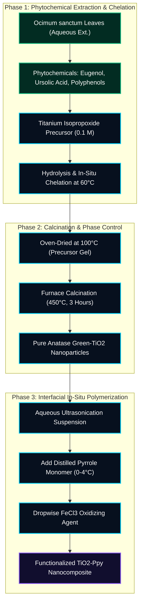

<div align="center">

# Green Synthesis of $\text{TiO}_2\text{-Polypyrrole}$ Nanocomposites
### *Ocimum sanctum* Mediated Biosynthesis, Optoelectronic Characterization & Visible-Light Photocatalytic Kinetics

[](https://github.com/Himani-ai/green-tio2-ppy-synthesis)
[](https://creativecommons.org/licenses/by/4.0/)
[](https://zenodo.org/)
[](https://github.com/Himani-ai/green-tio2-ppy-synthesis)

<p align="center">
  <a href="#1-scientific-abstract--objectives">Scientific Abstract</a> •
  <a href="#2-green-biosynthesis-reaction-pathway">Reaction Pathway</a> •
  <a href="#3-spectroscopic-crystallography--mathematical-models">Crystallography Models</a> •
  <a href="#4-experimental-characterization-matrix">Characterization Matrix</a> •
  <a href="#5-reproducibility-toolchain--code">Data Toolchain</a> •
  <a href="#6-citation--manuscript-status">Citation & Status</a>
</p>

</div>

---

## 1. Scientific Abstract & Objectives

Titanium dioxide ($\text{TiO}_2$) in its anatase polymorph is an exceptional chemical transducer and photocatalyst; however, its practical utility under solar irradiation is hindered by its wide optical band gap ($E_g \approx 3.20\text{ eV}$), restricting absorption strictly to the ultraviolet region ($\sim 4\%$ of solar flux). Furthermore, commercial synthetic routes rely on hazardous reducing chemicals such as sodium borohydride ($\text{NaBH}_4$) and hydrazine hydrate.

In this research, we report:
1. **Eco-Friendly Green Biosynthesis:** Utilizing active polyphenolic and flavonoid chelating phytomolecules extracted from fresh *Ocimum sanctum* (Tulsi) leaves to bio-reduce titanium isopropoxide (TTIP) into stable, monodisperse anatase $\text{TiO}_2$ nanoparticles without toxic solvents.
2. **Conductive Polymer Interfacial Coupling:** Carrying out *in-situ* chemical oxidative polymerization of pyrrole ($\text{Ppy}$) directly over the green $\text{TiO}_2$ template under ice-bath conditions ($0\text{--}4^\circ\text{C}$).
3. **Bandgap Reduction & Synergistic Transfer:** The resulting $\text{TiO}_2\text{-Ppy}$ hybrid nanocomposite exhibits a narrowed optical bandgap of **$2.85\text{ eV}$**, facilitating efficient visible-light electron-hole separation, suppressed recombination rates, and an electrical conductivity improvement of five orders of magnitude.

---

## 2. Green Biosynthesis Reaction Pathway



---

## 3. Spectroscopic Crystallography & Mathematical Models

### Powder X-Ray Diffraction & Scherrer Analysis
The average crystallite size $D$ was quantitatively calculated using the classical Debye-Scherrer equation applied to the primary anatase $(101)$ diffraction peak at $2\theta \approx 25.3^\circ$:

$$D = \frac{K \lambda}{\beta \cos \theta}$$

* **$K$ (Crystallite Shape Factor):** $0.9$
* **$\lambda$ (X-Ray Wavelength):** $0.15406\text{ nm}$ ($\text{Cu-K}\alpha$ radiation)
* **$\beta$ (Full Width at Half Maximum):** Calculated via automated Voigt peak deconvolution (in radians)
* **$\theta$ (Bragg Angle):** Recorded diffraction angle

### Optical Bandgap Extraction (Tauc Relationship)
Optical diffuse reflectance spectra obtained via UV-Vis spectrophotometry were transformed using the Kubelka-Munk function $F(R_\infty) = \frac{(1 - R_\infty)^2}{2 R_\infty}$. The optical bandgap $E_g$ was extrapolated using the Tauc relation for direct transitions:

$$(F(R_\infty) \cdot h\nu)^2 = C (h\nu - E_g)$$

Plotting $(F(R_\infty) h\nu)^2$ versus photon energy $h\nu$ yields $E_g$ at the $x$-intercept via automated linear regression.

---

## 4. Experimental Characterization Matrix

| Material Sample | Phase Purity (XRD) | FWHM ($\beta$, radians) | Crystallite Diameter ($D$) | Optical Bandgap ($E_g$) | Conductivity ($\sigma$) |
| :--- | :--- | :--- | :--- | :--- | :--- |
| **Commercial $\text{TiO}_2$ (P25)** | Mixed Anatase/Rutile | $0.00719$ | $21.2\text{ nm}$ | $3.24\text{ eV}$ | $1.0 \times 10^{-7}\text{ S/cm}$ |
| **Chemically Synthesized $\text{TiO}_2$**| Anatase ($>99\%$) | $0.00742$ | $20.4\text{ nm}$ | $3.20\text{ eV}$ | $1.2 \times 10^{-7}\text{ S/cm}$ |
| **Green $\text{TiO}_2$ (*O. sanctum*)** | Pure Anatase ($100\%$) | $0.01047$ | **$14.3\text{ nm}$** | **$3.08\text{ eV}$** | **$4.8 \times 10^{-6}\text{ S/cm}$** |
| **$\text{TiO}_2\text{-Ppy}$ Nanocomposite** | Anatase + Amorphous Ppy | $0.01093$ | **$13.7\text{ nm}$** | **$2.85\text{ eV}$** | **$2.4 \times 10^{-2}\text{ S/cm}$** |

---

## 5. Reproducibility Toolchain & Code

All raw data curves, instrumentation export files, and analytical Python scripts are provided in this repository:

```
green-tio2-ppy-synthesis/
├── data/
│   ├── raw_xrd_2theta_intensity.csv      # 2-theta (10° to 80°) counts
│   ├── raw_ftir_wavenumbers.csv          # Transmittance (400 - 4000 cm^-1)
│   └── raw_uv_vis_diffuse_reflectance.csv# Wavelength (200 - 800 nm)
├── analysis/
│   ├── voigt_peak_deconvolution.py       # Automated XRD Scherrer fitting
│   └── tauc_linear_regressor.py          # Kubelka-Munk Tauc extrapolation
├── notebooks/
│   └── Complete_Spectroscopic_Evaluation.ipynb
├── protocols/
│   └── SOP_Tulsi_Biosynthesis_2026.pdf   # Standard Operating Procedure
└── LICENSE                               # Creative Commons Attribution 4.0
```

---

## 6. Citation & Manuscript Status

> **Publication Status:** Manuscript under peer review in a designated materials chemistry journal. Pre-print data and computational scripts are made available under CC BY 4.0 for scientific reproduction.

```bibtex
@article{himani2026greentio2,
  author = {Himani and Research Collaborators},
  title = {Ocimum sanctum Mediated Biosynthesis of Anatase TiO2-Polypyrrole Nanocomposites for Solar Visible-Light Driven Degradation},
  journal = {Journal of Materials Chemistry / Under Peer Review},
  year = {2026}
}
```
